# Classe_controle

Outil **original** de supervision de salle informatique (type « NetSupport School »),
écrit en **C# / .NET 8** avec interface **Avalonia**. Deux exécutables autonomes
(aucune installation, aucun runtime à poser) pour Windows 10/11 64 bits.

- **Console professeur** — découvre les postes, les verrouille, envoie messages
  et fichiers, lance/ferme des applications, voit et contrôle un écran à distance.
- **Agent élève** — tourne discrètement (icône de notification), exécute les
  ordres de la console.

> Usage **pédagogique encadré** uniquement, sur des postes dont vous avez la
> responsabilité. Ce n'est pas une copie de NetSupport : c'est une
> implémentation indépendante d'un protocole simple.

## Téléchargement

Dernière version : **[page des versions](https://github.com/yacineboulyali/ClasseControl/releases/latest)**

| Fichier | À utiliser pour |
|---|---|
| [**ClasseControle-Setup.exe**](https://github.com/yacineboulyali/ClasseControl/releases/latest/download/ClasseControle-Setup.exe) | **Installateur (recommandé)** : au premier écran, choisir « Poste du professeur » ou « Poste élève » |
| [ClasseControle-portable.zip](https://github.com/yacineboulyali/ClasseControl/releases/latest/download/ClasseControle-portable.zip) | Version sans installation : console + agent + guide + `agent.ini` |
| [ClasseControle.Console.exe](https://github.com/yacineboulyali/ClasseControl/releases/latest/download/ClasseControle.Console.exe) | Console du professeur seule (un seul .exe) |
| [ClasseControle.Agent.exe](https://github.com/yacineboulyali/ClasseControl/releases/latest/download/ClasseControle.Agent.exe) | Agent élève seul (un seul .exe) |

Windows 10/11 64 bits, aucun prérequis (.NET est inclus). Les .exe ne sont pas
signés : au premier lancement, SmartScreen peut demander « Informations
complémentaires » → « Exécuter quand même ».

## Aperçu en images

> Captures réalisées avec la vraie console et six postes élèves simulés.

### Console du professeur


*Vue générale : ruban de commandes en haut, barre latérale à gauche, une vignette par poste avec l'écran de l'élève en direct, son nom, ses étoiles et ses badges (« Aide », « Verrouillé », « Internet coupé »). Le zoom des vignettes est en bas à droite.*

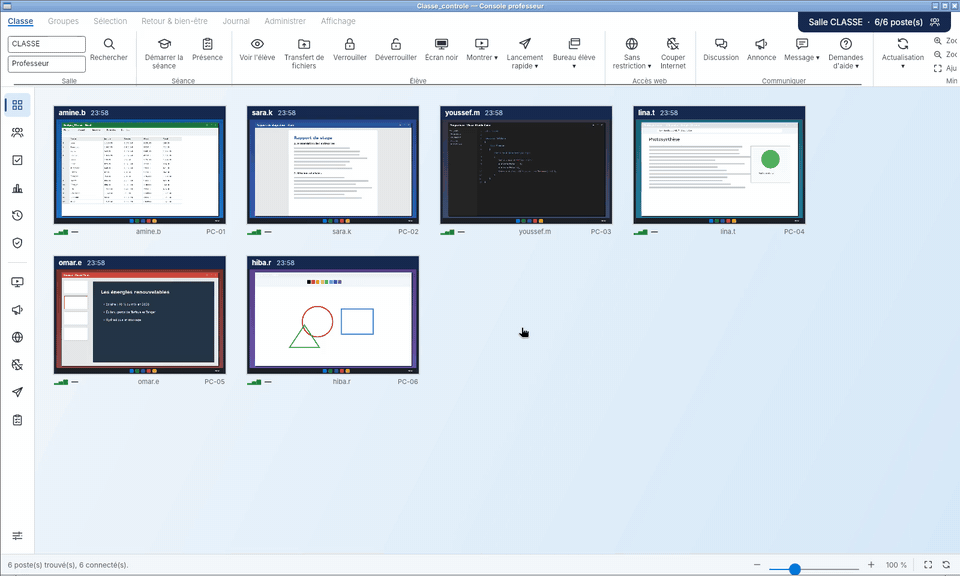
*Démarrer la séance : le professeur donne un titre, chaque élève saisit son nom sur son poste et les noms apparaissent un à un sur les vignettes.*

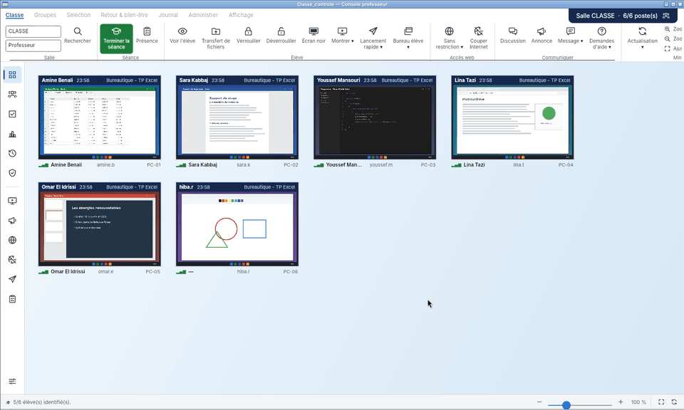
*Main levée : l'élève demande de l'aide depuis l'icône près de l'horloge ; sa vignette passe en orange, remonte en tête, et la demande s'ajoute à la liste « Demandes d'aide ».*

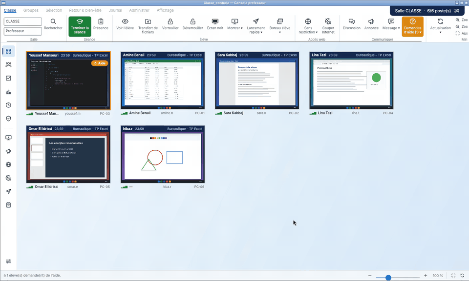
*Verrouiller / Écran noir : on sélectionne des postes (clic, Ctrl+clic) puis on les verrouille ou on leur met un écran noir ; « Déverrouiller » sans sélection rend la main à toute la classe.*

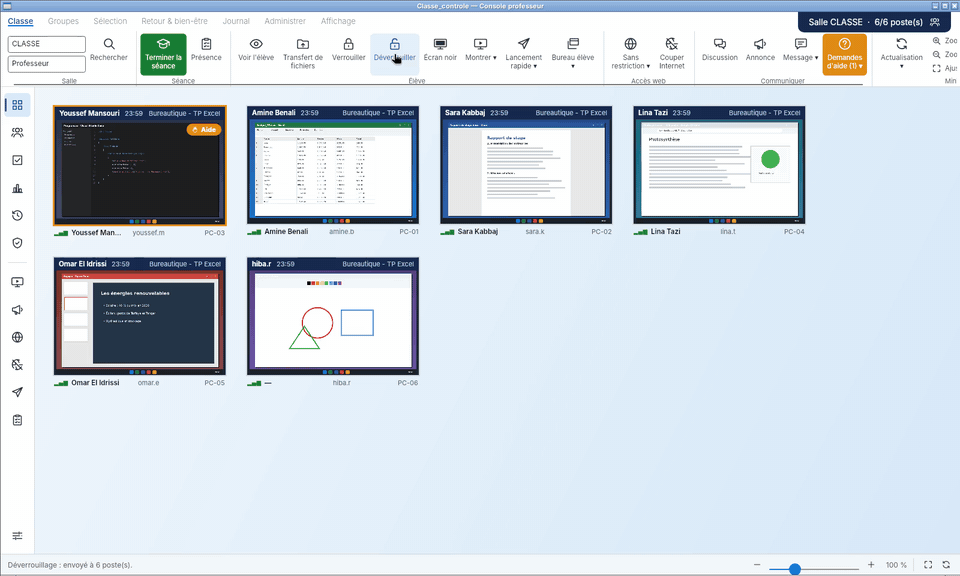
*Couper Internet : un clic coupe l'accès à Internet sur la classe (ou la sélection) tout en gardant le réseau de la salle ; un second clic le rétablit.*


*Zoom : − / + / curseur pour agrandir ou réduire les écrans des élèves, « Ajuster » pour tout voir sans défiler (aussi avec Ctrl + molette).*

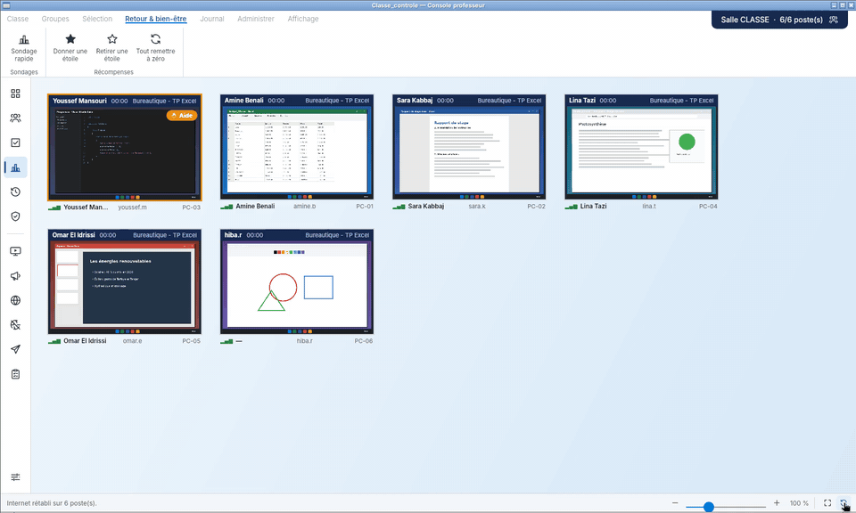
*Sondage rapide : une question, des réponses toutes prêtes (Oui/Non, Compris ?, A B C D…) et les résultats qui s'affichent en direct.*


*Équipes : répartition aléatoire selon le nombre d'élèves par équipe, puis chaque équipe complète en même temps un document partagé (ici à partir d'un modèle) ; le professeur suit tout en direct.*


*Clic droit sur une vignette : toutes les actions pour ce poste (ou la sélection) — verrouiller, écran noir, couper Internet, voir, fichier, discussion, message, lancer, présenter, étoiles, alimentation.*

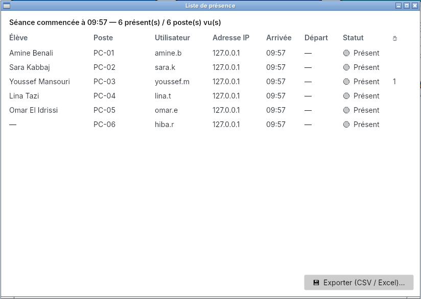
*Liste de présence : élève, poste, heure d'arrivée et de départ, mains levées ; export CSV pour Excel.*

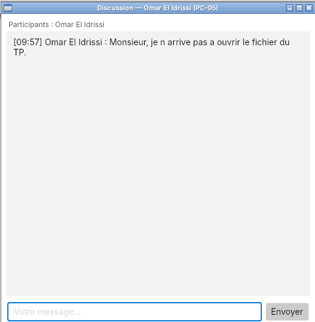
*Discussion : quand un élève écrit au professeur, la fenêtre s'ouvre automatiquement sur la console.*

### Poste de l'élève

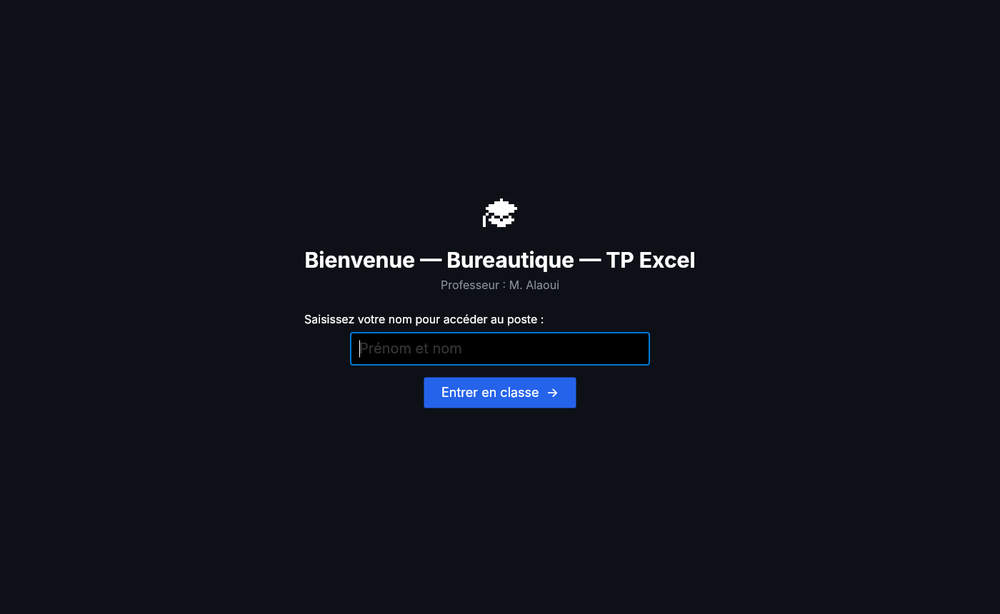
*Entrée en séance : pendant une séance, l'élève doit saisir son prénom et son nom pour accéder à son poste.*

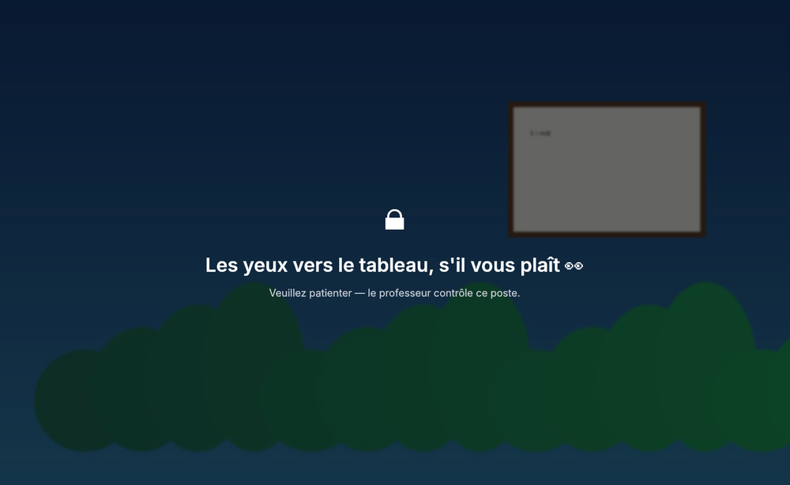
*Écran verrouillé : texte et image choisis par le professeur dans ⚙ Paramètres.*

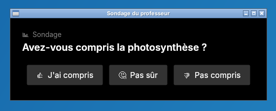
*Sondage : l'élève répond d'un clic.*


*Espace d'équipe : document partagé édité à plusieurs en même temps et discussion de l'équipe.*

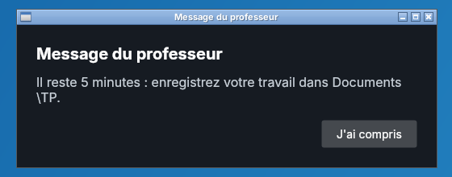
*Message du professeur : consigne affichée au premier plan.*

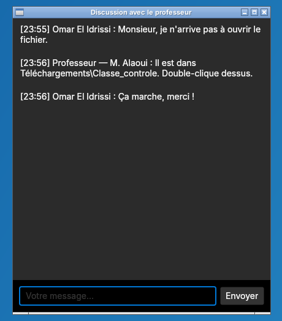
*Discussion avec le professeur, ouverte depuis l'icône de l'agent.*

## Architecture

```
ClasseControle.Common    Protocole réseau partagé (messages + encodage fil)
ClasseControle.Agent     Poste élève  (Avalonia + API Windows P/Invoke)
ClasseControle.Console   Poste prof   (Avalonia)
```

- **Découverte** : broadcast UDP (port 5401), filtré par un *code de salle*.
- **Contrôle** : TCP (port 5402), messages JSON préfixés par leur longueur.
- **Écran** : capture GDI `BitBlt` → JPEG, streaming à quelques images/seconde.
- **Contrôle à distance** : `SendInput` (souris/clavier), coordonnées normalisées.

## Interface de la console

- **Ruban à onglets** : Classe · Groupes · Sélection · Retour & bien-être ·
  Journal · Administrer · Affichage, avec de grandes icônes groupées
  (Salle, Séance, Élève, Accès web, Communiquer, Miniatures…)
- **Barre latérale** d'accès rapide (classe, diffusion, annonce, sondage,
  web, équipes, présence, journal, paramètres)
- **Vignettes** : bandeau (élève, heure, étoiles, séance), écran en direct,
  pied (élève · utilisateur · poste), indicateur de signal, badges
  « Aide », « Verrouillé », « Écran noir »
- Clic = sélection (Ctrl+clic pour plusieurs, Échap pour tout désélectionner),
  double-clic = voir l'écran, **clic droit = palette d'actions** (verrouiller,
  écran noir, voir, fichier, discussion, message, lancer, présenter, étoiles,
  gérer l'alimentation…)
- **Icônes vectorielles maison**, flat design monochrome (aucune police ni
  image à installer), qui réagissent au survol, à l'appui et à l'état actif
  (diffusion/annonce en rouge, alerte en orange, séance en vert)
- **Zoom des vignettes** en bas à droite : − / curseur / + (de 50 % à 240 %),
  « Ajuster » (tous les postes visibles sans défiler), « 100 % », et
  **Ctrl + molette** ; la résolution des miniatures suit le zoom
- Les commandes s'appliquent à la **sélection**, ou à **toute la classe** si
  rien n'est sélectionné

## Fonctionnalités

- 🖥️ **Miniatures de tous les écrans en direct** dans la console
- 🔒 Verrouiller / déverrouiller un poste ou toute la classe
- 💬 Message / consigne à un poste ou à la classe
- 👁 Voir l'écran d'un élève en grand **+ prise de contrôle** souris/clavier
- 📁 Envoyer un fichier (toute la classe ou sélection)
- 🚀 Lancer une application ou une URL à distance
- ✖ Fermer une application à distance (par nom de processus)
- ⏻ **Éteindre / redémarrer / déconnecter** les postes à distance (avec confirmation)
- ☑️ Sélection groupée (tout / rien / par poste)
- 📺 **Diffusion de l'écran du professeur** vers la classe (plein écran avec
  clavier/souris bloqués, ou en fenêtre)
- ⛔ **Restrictions** : applications interdites (fermées automatiquement) et
  sites interdits (onglet fermé si son titre contient un mot-clé)
- ✋ **Main levée** : l'élève demande de l'aide depuis l'icône de notification,
  la carte du poste passe en orange et remonte en tête
- 📋 **Liste de présence** de la séance (arrivée, départ, mains levées),
  export CSV pour Excel
- 🎓 **Démarrer la séance** : chaque élève doit saisir son prénom et son nom
  (écran plein écran) pour accéder à son poste ; les noms apparaissent sur les
  cartes, dans la présence et dans les équipes
- 🌐 **Ouvrir un site web** sur tous les postes (navigateur par défaut)
- 🖼 **Écran de verrouillage personnalisé** : texte et image choisis dans
  ⚙ Paramètres
- 📡 **Diffuser l'écran d'un élève** à toute la classe (relayé par la console)
- 👥 **Équipes** : répartition aléatoire (nombre d'élèves par équipe) ou
  manuelle, avec pour chaque équipe un **document partagé** édité à plusieurs
  en même temps et une **discussion** ; **modèle de document** (plan à
  compléter) ; suivi en direct et export des travaux. La fusion des saisies
  simultanées repose sur une transformation opérationnelle testée (chaque
  phrase reste d'un seul tenant)
- 🌙 **Écran noir** (attirer l'attention), distinct du verrouillage
- 📵 **Couper Internet** sur la classe ou la sélection, le réseau de la salle
  restant joignable (pare-feu Windows si l'agent est administrateur, sinon
  proxy système) ; Internet est toujours rétabli à l'arrêt de l'agent
- 💬 **Discussion** professeur ↔ élève (l'élève peut écrire depuis l'icône)
- 📢 **Annonce audio** : le micro du professeur diffusé en direct
- ⭐ **Récompenses** : donner / retirer des étoiles, visibles sur la vignette,
  chez l'élève et dans l'export de présence
- 📊 **Sondage rapide** avec modèles (Oui/Non, Compris ?, A-B-C-D, humeur…)
  et résultats en direct
- 🌐 **Accès web** : sans restriction / sites interdits / **sites approuvés
  uniquement** / **web bloqué**
- 🚀 **Lancement rapide** : favoris configurables (Word, Excel, sites…)
- 🖥 **Bureau élève** : réduire toutes les fenêtres, fermer toutes les applications
- ✋ **Demandes d'aide** : liste des mains levées dans le ruban
- 📜 **Journal des actions** du professeur, enregistré automatiquement dans
  `Documents\Classe_controle\journal-AAAA-MM-JJ.csv`

## Installation (recommandée)

Un seul installateur ; au premier écran on choisit le **type de poste** :

| Choix | Ce qui est installé |
|---|---|
| **Poste du professeur** | La console, avec raccourcis menu Démarrer et Bureau |
| **Poste élève** | Uniquement l'agent, **sans aucun raccourci** : il démarre seul à chaque ouverture de session (tâche planifiée cachée, relancée automatiquement) et n'apparaît que dans la zone de notification. Le code de salle est demandé pendant l'installation. Les règles du pare-feu sont créées automatiquement. |

Déploiement silencieux sur toute une salle :

```bat
ClasseControle-Setup-1.5.0.exe /VERYSILENT /ROLE=eleve /ROOM=CLASSE
ClasseControle-Setup-1.5.0.exe /VERYSILENT /ROLE=prof
```

Pour construire l'installateur (sous Windows, avec le SDK .NET 8 et
[Inno Setup 6](https://jrsoftware.org/isinfo.php)) :

```powershell
powershell -ExecutionPolicy Bypass -File installer\build.ps1
```

> L'agent élève n'est pas un « service Windows » au sens strict : un service
> tourne dans une session invisible (session 0) et ne pourrait ni afficher
> l'écran de verrouillage ni capturer l'écran de l'élève. La tâche planifiée
> joue le même rôle (démarrage automatique, arrière-plan, relance).

## Compilation

Nécessite le SDK .NET 8.

```bash
# Console professeur (exe autonome)
dotnet publish ClasseControle.Console/ClasseControle.Console.csproj \
  -c Release -r win-x64 --self-contained true \
  -p:PublishSingleFile=true -p:IncludeNativeLibrariesForSelfExtract=true \
  -p:EnableCompressionInSingleFile=true -o publish/console

# Agent élève (exe autonome)
dotnet publish ClasseControle.Agent/ClasseControle.Agent.csproj \
  -c Release -r win-x64 --self-contained true \
  -p:PublishSingleFile=true -p:IncludeNativeLibrariesForSelfExtract=true \
  -p:EnableCompressionInSingleFile=true -o publish/agent
```

> Les projets Agent/Console ciblent `net8.0` + Avalonia et se **compilent depuis
> Linux ou Windows** ; les API Windows (capture, injection) ne s'exécutent que
> sous Windows (cible `win-x64`).

## Configuration de l'agent

Fichier `agent.ini` créé à côté de l'exe au premier lancement :

```ini
RoomCode=CLASSE          # doit être identique à celui de la console
DisplayName=NOM-DU-PC    # nom affiché dans la console
```

## Pistes v1.5+

- Chiffrement TLS du canal de contrôle + mot de passe fort
- Service Windows « gardien » qui relance l'agent + déploiement MSI/GPO
- Contrôle des imprimantes et des clés USB, planificateur de travaux
- Blocage des sites au niveau réseau (proxy / DNS) en complément du blocage par titre
- Sondages / quiz rapides envoyés à la classe

## Licence

À définir par l'auteur (ex. MIT). Code original.
