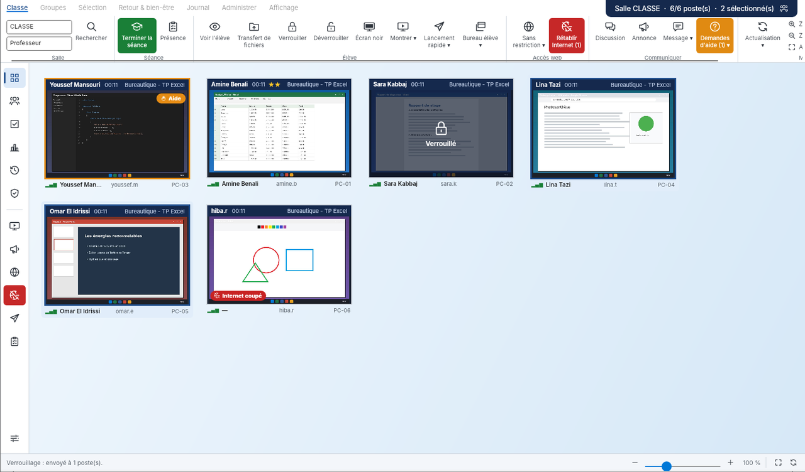
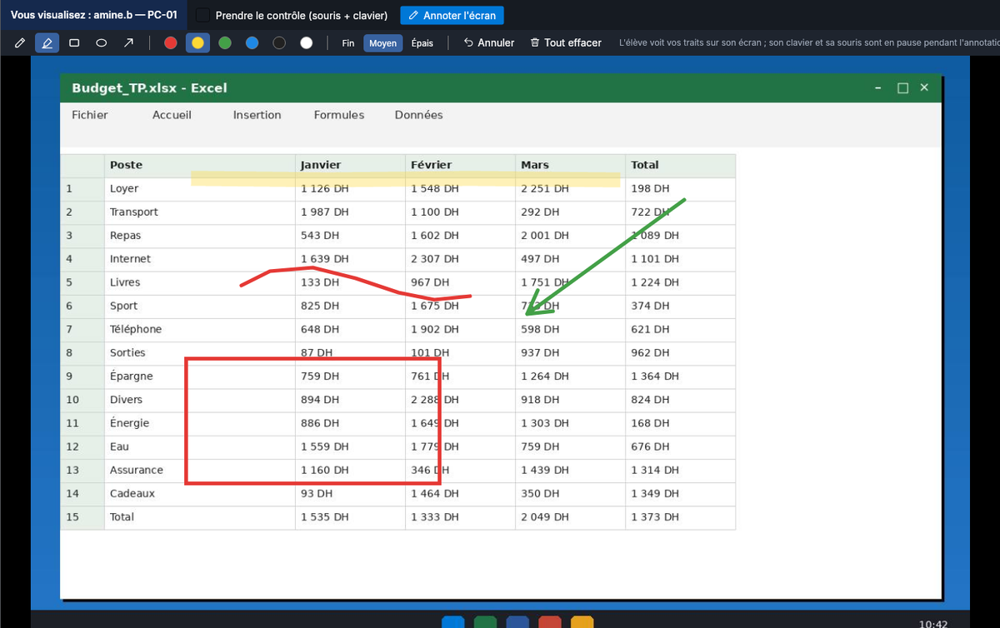
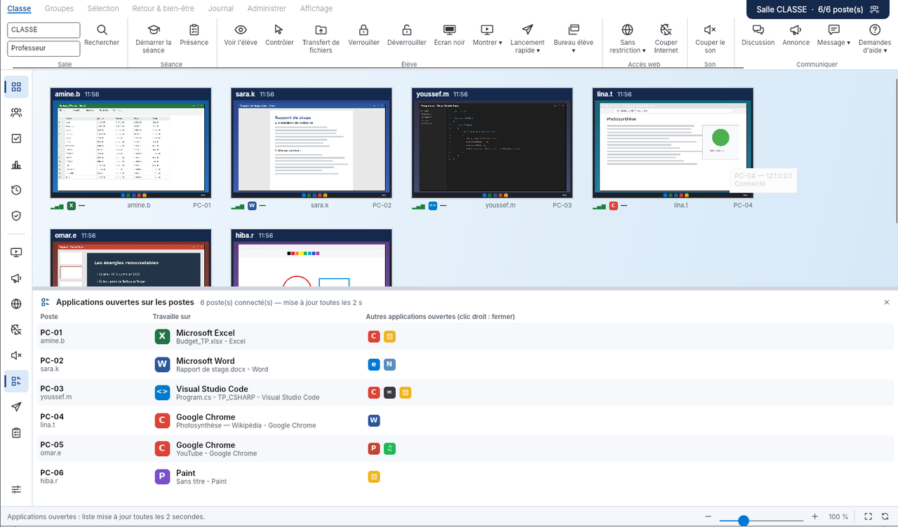
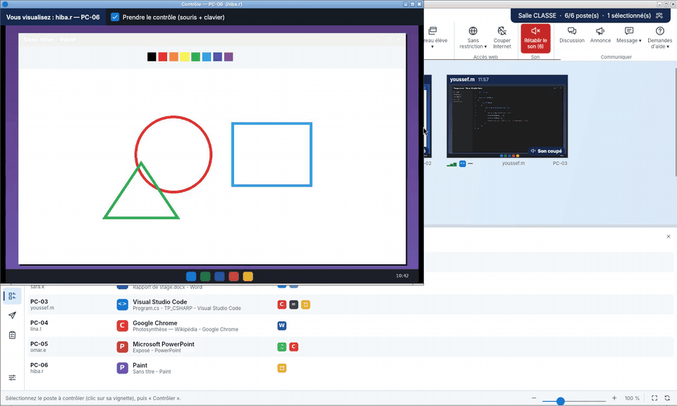
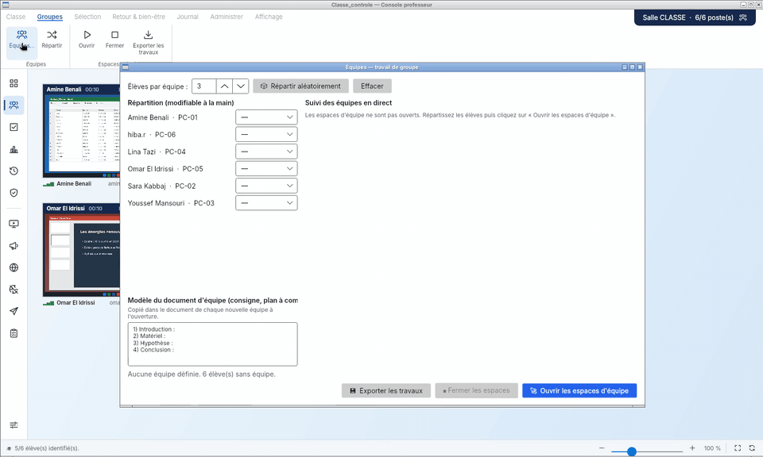
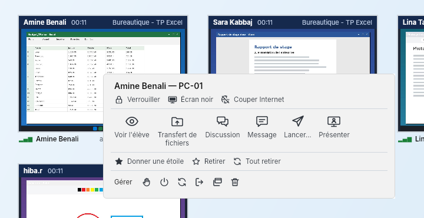
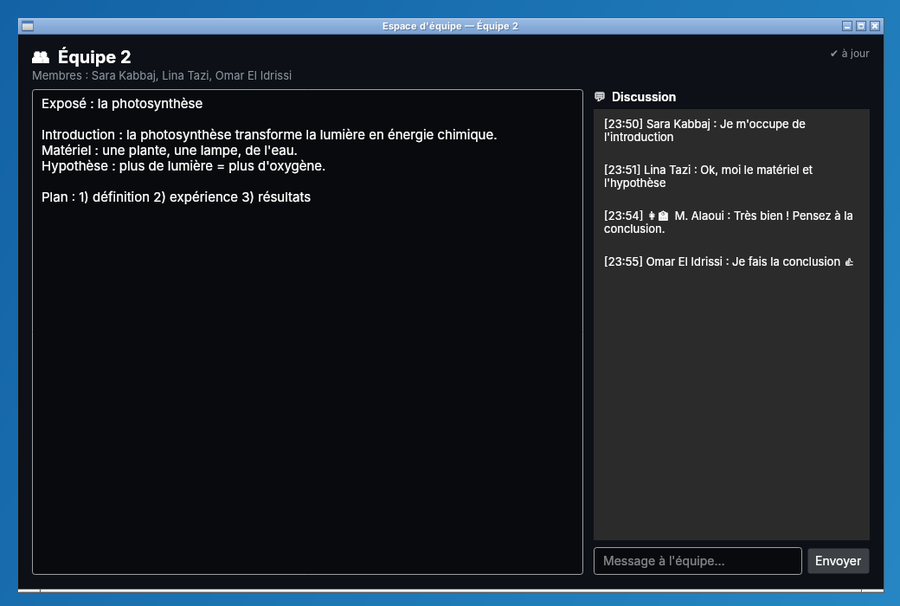

# Classe_controle

Outil **original** de supervision de salle informatique (type « NetSupport School »),
écrit en **C# / .NET 8** avec interface **Avalonia**. **Une seule application**
autonome (`ClasseControle.exe`, aucun runtime à poser) pour Windows 10/11 64 bits,
qui fonctionne selon le mode choisi :

- **Mode professeur (console)** — découvre les postes, les verrouille, envoie
  messages et fichiers, lance/ferme des applications, voit et contrôle un écran.
- **Mode élève (agent)** — tourne discrètement (icône de notification), exécute
  les ordres de la console.

Le mode est choisi à l'installation, ou au premier lancement (écran de choix).
Options : `--prof`, `--eleve`, `--choisir` (redemander le mode).

> Usage **pédagogique encadré** uniquement, sur des postes dont vous avez la
> responsabilité. Ce n'est pas une copie de NetSupport : c'est une
> implémentation indépendante d'un protocole simple.

## Téléchargement

**Une seule application** pour le professeur et pour les élèves : le mode est
choisi à l'installation (ou au premier lancement de la version sans installation).

### Dernière version

| Fichier | À utiliser pour |
|---|---|
| [**ClasseControle-Setup.exe**](https://github.com/yacineboulyali/ClasseControl/releases/latest/download/ClasseControle-Setup.exe) | **Installateur (recommandé)** : au premier écran, choisir « Poste du professeur » ou « Poste élève » |
| [ClasseControle.exe](https://github.com/yacineboulyali/ClasseControl/releases/latest/download/ClasseControle.exe) | L'application seule, sans installation : le mode est demandé au premier lancement |
| [ClasseControle-portable.zip](https://github.com/yacineboulyali/ClasseControl/releases/latest/download/ClasseControle-portable.zip) | L'application + le guide d'utilisation |

Windows 10/11 64 bits, aucun prérequis (.NET est inclus). Les .exe ne sont pas
signés : au premier lancement, SmartScreen peut demander « Informations
complémentaires » → « Exécuter quand même ».

### Toutes les versions

| Version | Téléchargements |
|---|---|
| **1.11.0** — annotation de l'écran, verrouillage Wi-Fi/Bluetooth | [Installateur](https://github.com/yacineboulyali/ClasseControl/releases/download/v1.11.0/ClasseControle-Setup.exe) · [ClasseControle.exe](https://github.com/yacineboulyali/ClasseControl/releases/download/v1.11.0/ClasseControle.exe) · [Portable (.zip)](https://github.com/yacineboulyali/ClasseControl/releases/download/v1.11.0/ClasseControle-portable.zip) · [Notes](https://github.com/yacineboulyali/ClasseControl/releases/tag/v1.11.0) |
| **1.10.0** — mise à jour automatique depuis GitHub | [Installateur](https://github.com/yacineboulyali/ClasseControl/releases/download/v1.10.0/ClasseControle-Setup.exe) · [ClasseControle.exe](https://github.com/yacineboulyali/ClasseControl/releases/download/v1.10.0/ClasseControle.exe) · [Portable (.zip)](https://github.com/yacineboulyali/ClasseControl/releases/download/v1.10.0/ClasseControle-portable.zip) · [Notes](https://github.com/yacineboulyali/ClasseControl/releases/tag/v1.10.0) |
| **1.9.1** — installateur : suppression des jeux Windows pour tous les utilisateurs | [Installateur](https://github.com/yacineboulyali/ClasseControl/releases/download/v1.9.1/ClasseControle-Setup.exe) · [ClasseControle.exe](https://github.com/yacineboulyali/ClasseControl/releases/download/v1.9.1/ClasseControle.exe) · [Portable (.zip)](https://github.com/yacineboulyali/ClasseControl/releases/download/v1.9.1/ClasseControle-portable.zip) · [Notes](https://github.com/yacineboulyali/ClasseControl/releases/tag/v1.9.1) |
| **1.9.0** — restrictions par élève, jeux Windows bloqués ou désinstallés | [Installateur](https://github.com/yacineboulyali/ClasseControl/releases/download/v1.9.0/ClasseControle-Setup.exe) · [ClasseControle.exe](https://github.com/yacineboulyali/ClasseControl/releases/download/v1.9.0/ClasseControle.exe) · [Portable (.zip)](https://github.com/yacineboulyali/ClasseControl/releases/download/v1.9.0/ClasseControle-portable.zip) · [Notes](https://github.com/yacineboulyali/ClasseControl/releases/tag/v1.9.0) |
| **1.8.0** — blocage du clavier et de la souris | [Installateur](https://github.com/yacineboulyali/ClasseControl/releases/download/v1.8.0/ClasseControle-Setup.exe) · [ClasseControle.exe](https://github.com/yacineboulyali/ClasseControl/releases/download/v1.8.0/ClasseControle.exe) · [Portable (.zip)](https://github.com/yacineboulyali/ClasseControl/releases/download/v1.8.0/ClasseControle-portable.zip) · [Notes](https://github.com/yacineboulyali/ClasseControl/releases/tag/v1.8.0) |
| **1.7.0** — applications ouvertes, son coupé, glisser-déposer, contrôle direct | [Installateur](https://github.com/yacineboulyali/ClasseControl/releases/download/v1.7.0/ClasseControle-Setup.exe) · [ClasseControle.exe](https://github.com/yacineboulyali/ClasseControl/releases/download/v1.7.0/ClasseControle.exe) · [Portable (.zip)](https://github.com/yacineboulyali/ClasseControl/releases/download/v1.7.0/ClasseControle-portable.zip) · [Notes](https://github.com/yacineboulyali/ClasseControl/releases/tag/v1.7.0) |
| **1.6.0** — application unique (prof + élève) | [Installateur](https://github.com/yacineboulyali/ClasseControl/releases/download/v1.6.0/ClasseControle-Setup.exe) · [ClasseControle.exe](https://github.com/yacineboulyali/ClasseControl/releases/download/v1.6.0/ClasseControle.exe) · [Portable (.zip)](https://github.com/yacineboulyali/ClasseControl/releases/download/v1.6.0/ClasseControle-portable.zip) · [Notes](https://github.com/yacineboulyali/ClasseControl/releases/tag/v1.6.0) |
| **1.5.0** — couper Internet, documentation illustrée | [Installateur](https://github.com/yacineboulyali/ClasseControl/releases/download/v1.5.0/ClasseControle-Setup.exe) · [Console](https://github.com/yacineboulyali/ClasseControl/releases/download/v1.5.0/ClasseControle.Console.exe) · [Agent](https://github.com/yacineboulyali/ClasseControl/releases/download/v1.5.0/ClasseControle.Agent.exe) · [Portable (.zip)](https://github.com/yacineboulyali/ClasseControl/releases/download/v1.5.0/ClasseControle-portable.zip) · [Notes](https://github.com/yacineboulyali/ClasseControl/releases/tag/v1.5.0) |
| 1.4 — interface à ruban, sondages, étoiles | [Code source (.zip)](https://github.com/yacineboulyali/ClasseControl/archive/1f3f734.zip) |
| 1.3 — installateur, séance, équipes | [Code source (.zip)](https://github.com/yacineboulyali/ClasseControl/archive/c2425a7.zip) |
| 1.2 — diffusion d'écran, restrictions, présence | [Code source (.zip)](https://github.com/yacineboulyali/ClasseControl/archive/9c210ae.zip) |
| 1.1 — miniatures live, alimentation à distance | [Code source (.zip)](https://github.com/yacineboulyali/ClasseControl/archive/bd490c6.zip) |

Les versions 1.1 à 1.4 n'ont pas été publiées en exécutables : leur code source
se compile avec `installer\build.ps1` (voir « Compilation »). Liste complète :
[page des versions](https://github.com/yacineboulyali/ClasseControl/releases).

## Aperçu en images

> Captures réalisées avec la vraie console et six postes élèves simulés.

### Console du professeur


*Vue générale : ruban de commandes en haut, barre latérale à gauche, une vignette par poste avec l'écran de l'élève en direct, son nom, ses étoiles et ses badges (« Aide », « Verrouillé », « Internet coupé »). Le zoom des vignettes est en bas à droite.*


*Annoter l'écran : le professeur dessine par-dessus l'écran de l'élève (stylo, surligneur, rectangle, cercle, flèche, couleurs) ; l'élève voit les mêmes traits sur son écran, en direct.*


*Applications ouvertes : le bouton de la barre latérale partage l'écran ; en bas, chaque poste avec l'élève, l'icône et le titre de l'application sur laquelle il travaille, et ses autres applications (clic droit sur une icône : fermer l'application). Les badges « Son coupé » indiquent les postes dont le son est coupé.*


*Glisser-déposer : on déplace une vignette pour reproduire le plan de la salle ; l'ordre est mémorisé pour les séances suivantes.*


*Démarrer la séance : le professeur donne un titre, chaque élève saisit son nom sur son poste et les noms apparaissent un à un sur les vignettes.*


*Main levée : l'élève demande de l'aide depuis l'icône près de l'horloge ; sa vignette passe en orange, remonte en tête, et la demande s'ajoute à la liste « Demandes d'aide ».*


*Verrouiller / Écran noir : on sélectionne des postes (clic, Ctrl+clic) puis on les verrouille ou on leur met un écran noir ; « Déverrouiller » sans sélection rend la main à toute la classe.*


*Couper Internet : un clic coupe l'accès à Internet sur la classe (ou la sélection) tout en gardant le réseau de la salle ; un second clic le rétablit.*


*Zoom : − / + / curseur pour agrandir ou réduire les écrans des élèves, « Ajuster » pour tout voir sans défiler (aussi avec Ctrl + molette).*


*Sondage rapide : une question, des réponses toutes prêtes (Oui/Non, Compris ?, A B C D…) et les résultats qui s'affichent en direct.*


*Équipes : répartition aléatoire selon le nombre d'élèves par équipe, puis chaque équipe complète en même temps un document partagé (ici à partir d'un modèle) ; le professeur suit tout en direct.*


*Clic droit sur une vignette : toutes les actions pour ce poste (ou la sélection) — verrouiller, écran noir, couper Internet, voir, fichier, discussion, message, lancer, présenter, étoiles, alimentation.*


*Liste de présence : élève, poste, heure d'arrivée et de départ, mains levées ; export CSV pour Excel.*


*Discussion : quand un élève écrit au professeur, la fenêtre s'ouvre automatiquement sur la console.*

### Poste de l'élève


*Entrée en séance : pendant une séance, l'élève doit saisir son prénom et son nom pour accéder à son poste.*


*Écran verrouillé : texte et image choisis par le professeur dans ⚙ Paramètres.*


*Sondage : l'élève répond d'un clic.*


*Espace d'équipe : document partagé édité à plusieurs en même temps et discussion de l'équipe.*


*Message du professeur : consigne affichée au premier plan.*


*Discussion avec le professeur, ouverte depuis l'icône de l'agent.*

## Architecture

```
ClasseControle.App       Application unique ClasseControle.exe : choix du mode, lancement
ClasseControle.Common    Protocole réseau, capture d'écran, document partagé (OT),
                         catalogue des restrictions, version / mises à jour
ClasseControle.Agent     Mode élève   (bibliothèque : Avalonia + API Windows)
ClasseControle.Console   Mode prof    (bibliothèque : Avalonia, ruban, vignettes…)
ClasseControle.Shared    Rendu des annotations, commun à la console et à l'agent
installer/               Installateur Inno Setup + scripts PowerShell (tâches
                         planifiées, pare-feu, jeux Windows, mise à jour auto)
.github/workflows/       Publication automatique d'une version sur GitHub
```

- **Découverte** : broadcast UDP (port 5401), filtré par un *code de salle*.
- **Contrôle** : TCP (port 5402), messages JSON préfixés par leur longueur.
- **Écran** : capture GDI `BitBlt` → JPEG, streaming à quelques images/seconde.
- **Contrôle à distance** : `SendInput` (souris/clavier), coordonnées normalisées.

## Interface de la console

- **Ruban à onglets** : Classe · Groupes · Sélection · Retour & bien-être ·
  Journal · Administrer · Affichage, avec de grandes icônes groupées
  (Salle, Séance, Élève, Accès web, Communiquer, Miniatures…)
- **Barre latérale** d'accès rapide (classe, diffusion, annonce, sondage,
  web, équipes, présence, journal, paramètres)
- **Vignettes** : bandeau (élève, heure, étoiles, séance), écran en direct,
  pied (élève · utilisateur · poste), indicateur de signal, badges
  « Aide », « Verrouillé », « Écran noir »
- Clic = sélection (Ctrl+clic pour plusieurs, Échap pour tout désélectionner),
  double-clic = voir l'écran, **clic droit = palette d'actions** (verrouiller,
  écran noir, voir, fichier, discussion, message, lancer, présenter, étoiles,
  gérer l'alimentation…)
- **Icônes vectorielles maison**, flat design monochrome (aucune police ni
  image à installer), qui réagissent au survol, à l'appui et à l'état actif
  (diffusion/annonce en rouge, alerte en orange, séance en vert)
- **Zoom des vignettes** en bas à droite : − / curseur / + (de 50 % à 240 %),
  « Ajuster » (tous les postes visibles sans défiler), « 100 % », et
  **Ctrl + molette** ; la résolution des miniatures suit le zoom
- Les commandes s'appliquent à la **sélection**, ou à **toute la classe** si
  rien n'est sélectionné

## Fonctionnalités

- 🖥️ **Miniatures de tous les écrans en direct** dans la console
- 🔒 Verrouiller / déverrouiller un poste ou toute la classe
- 💬 Message / consigne à un poste ou à la classe
- 👁 Voir l'écran d'un élève en grand **+ prise de contrôle** souris/clavier
- 📁 Envoyer un fichier (toute la classe ou sélection)
- 🚀 Lancer une application ou une URL à distance
- ✖ Fermer une application à distance (par nom de processus)
- ⏻ **Éteindre / redémarrer / déconnecter** les postes à distance (avec confirmation)
- ☑️ Sélection groupée (tout / rien / par poste)
- 📺 **Diffusion de l'écran du professeur** vers la classe (plein écran avec
  clavier/souris bloqués, ou en fenêtre)
- ⛔ **Restrictions par élève ou pour la classe** (clic droit sur une vignette →
  restrictions de ce poste, mémorisées et réappliquées à chaque connexion) :
  catégories prêtes (**jeux préinstallés de Windows** : Solitaire, Candy Crush,
  Minecraft, Mahjong…, plateformes de jeux, messageries, réseaux sociaux, vidéo,
  jeux en ligne) + listes libres d'applications et de sites
- 🎮 **Jeux préinstallés de Windows** : bloqués (reconnus par leur paquet du Store)
  ou **désinstallés** d'un clic pour l'utilisateur du poste (Administrer)
- ✋ **Main levée** : l'élève demande de l'aide depuis l'icône de notification,
  la carte du poste passe en orange et remonte en tête
- 📋 **Liste de présence** de la séance (arrivée, départ, mains levées),
  export CSV pour Excel
- 🎓 **Démarrer la séance** : chaque élève doit saisir son prénom et son nom
  (écran plein écran) pour accéder à son poste ; les noms apparaissent sur les
  cartes, dans la présence et dans les équipes
- 🌐 **Ouvrir un site web** sur tous les postes (navigateur par défaut)
- 🖼 **Écran de verrouillage personnalisé** : texte et image choisis dans
  ⚙ Paramètres
- 📡 **Diffuser l'écran d'un élève** à toute la classe (relayé par la console)
- 👥 **Équipes** : répartition aléatoire (nombre d'élèves par équipe) ou
  manuelle, avec pour chaque équipe un **document partagé** édité à plusieurs
  en même temps et une **discussion** ; **modèle de document** (plan à
  compléter) ; suivi en direct et export des travaux. La fusion des saisies
  simultanées repose sur une transformation opérationnelle testée (chaque
  phrase reste d'un seul tenant)
- 🖱 **Contrôler** un poste en un clic (ruban ou clic droit) : souris et clavier de l'élève
- 🧩 **Applications ouvertes** : bouton de la barre latérale qui partage l'écran en deux ;
  en bas, pour chaque poste (PC), l'élève, l'**icône et le titre de l'application sur
  laquelle il travaille** et ses autres applications (clic droit : fermer)
- ✏ **Annoter l'écran d'un élève** : stylo, surligneur, rectangle, cercle, flèche,
  6 couleurs, 3 épaisseurs, annuler (Ctrl+Z), tout effacer ; l'élève voit les traits
  en direct sur son propre écran
- 📶 **Verrouiller le Wi-Fi et le Bluetooth** : l'élève ne peut plus les allumer, les
  éteindre ni changer de réseau Wi-Fi (partage de connexion du téléphone…) — toute
  modification est annulée en 2 secondes
- ⌨ **Bloquer le clavier et la souris** des élèves sans masquer leur écran (bandeau
  d'information chez l'élève) ; le professeur peut toujours prendre le contrôle.
  Le verrouillage, l'écran noir et la diffusion plein écran bloquent aussi les
  entrées physiques (Alt+Tab, touche Windows…). Déblocage automatique après 60 s
  si la console se déconnecte
- 🔇 **Couper le son** des applications des élèves (les annonces du professeur restent audibles)
- ↔ **Glisser-déposer les vignettes** pour reproduire le plan de la salle (ordre mémorisé)
- 🌙 **Écran noir** (attirer l'attention), distinct du verrouillage
- 📵 **Couper Internet** sur la classe ou la sélection, le réseau de la salle
  restant joignable (pare-feu Windows si l'agent est administrateur, sinon
  proxy système) ; Internet est toujours rétabli à l'arrêt de l'agent
- 💬 **Discussion** professeur ↔ élève (l'élève peut écrire depuis l'icône)
- 📢 **Annonce audio** : le micro du professeur diffusé en direct
- ⭐ **Récompenses** : donner / retirer des étoiles, visibles sur la vignette,
  chez l'élève et dans l'export de présence
- 📊 **Sondage rapide** avec modèles (Oui/Non, Compris ?, A-B-C-D, humeur…)
  et résultats en direct
- 🌐 **Accès web** : sans restriction / sites interdits / **sites approuvés
  uniquement** / **web bloqué**
- 🚀 **Lancement rapide** : favoris configurables (Word, Excel, sites…)
- 🖥 **Bureau élève** : réduire toutes les fenêtres, fermer toutes les applications
- ✋ **Demandes d'aide** : liste des mains levées dans le ruban
- 📜 **Journal des actions** du professeur, enregistré automatiquement dans
  `Documents\Classe_controle\journal-AAAA-MM-JJ.csv`

## Installation (recommandée)

Un seul installateur ; au premier écran on choisit le **type de poste** :

| Choix | Ce qui est installé |
|---|---|
| **Poste du professeur** | `ClasseControle.exe` en mode console, avec raccourcis menu Démarrer et Bureau |
| **Poste élève** | `ClasseControle.exe` en mode agent, **sans aucun raccourci** : il démarre seul à chaque ouverture de session (tâche planifiée cachée, relancée automatiquement) et n'apparaît que dans la zone de notification. Le code de salle est demandé pendant l'installation. Les règles du pare-feu sont créées automatiquement. |

**Mise à jour automatique (option cochée par défaut, professeur et élève)** : une tâche
planifiée Windows (compte SYSTEM) vérifie toutes les heures et au démarrage la dernière
version publiée sur GitHub et l'installe toute seule. L'agent élève redémarre de lui-même
sur la nouvelle version ; la console propose de redémarrer. Seule la version officielle
GitHub est installée (rien n'est accepté depuis le réseau local). Dans la console :
version de chaque poste (⟳ si plus ancienne), boutons « Mettre à jour les postes » et
« Vérifier les mises à jour » (onglet Administrer). Journal :
`%ProgramData%\Classe_controle\update.log`. Il faut un accès à Internet (GitHub).

**Option du poste élève (cochée par défaut)** : « Supprimer les jeux préinstallés de Windows pour tous les utilisateurs ». L'installateur désinstalle Solitaire, Candy Crush, Minecraft, Mahjong, Démineur… de **tous les comptes** du poste, les **retire de l'image Windows** (les comptes créés plus tard ne les auront pas) et désactive l'installation automatique des jeux « suggérés » (Windows Éducation/Entreprise). Minecraft Éducation n'est pas concerné. Journal : `%ProgramData%\Classe_controle\remove-games.log`.

Déploiement silencieux sur toute une salle :

```bat
ClasseControle-Setup.exe /VERYSILENT /ROLE=eleve /ROOM=CLASSE
ClasseControle-Setup.exe /VERYSILENT /ROLE=prof
rem Poste élève sans supprimer les jeux :
ClasseControle-Setup.exe /VERYSILENT /ROLE=eleve /ROOM=CLASSE /MERGETASKS="!supprjeux"
rem Sans mise à jour automatique :
ClasseControle-Setup.exe /VERYSILENT /ROLE=eleve /ROOM=CLASSE /MERGETASKS="!majauto"
```

Pour construire l'installateur (sous Windows, avec le SDK .NET 8 et
[Inno Setup 6](https://jrsoftware.org/isinfo.php)) :

```powershell
powershell -ExecutionPolicy Bypass -File installer\build.ps1
```

> L'agent élève n'est pas un « service Windows » au sens strict : un service
> tourne dans une session invisible (session 0) et ne pourrait ni afficher
> l'écran de verrouillage ni capturer l'écran de l'élève. La tâche planifiée
> joue le même rôle (démarrage automatique, arrière-plan, relance).

## Compilation

Nécessite le SDK .NET 8 (cible `net8.0-windows10.0.19041.0` pour l'agent et
l'application ; se compile aussi depuis Linux).

```bash
# Application unique (exe autonome, console + agent)
dotnet publish ClasseControle.App/ClasseControle.App.csproj \
  -c Release -r win-x64 --self-contained true -p:Version=1.11.0 \
  -p:PublishSingleFile=true -p:IncludeNativeLibrariesForSelfExtract=true \
  -p:EnableCompressionInSingleFile=true -o publish/app
```

L'installateur se construit sous Windows avec `installer\build.ps1`
(Inno Setup 6). Les versions sont publiées automatiquement sur GitHub :
à chaque envoi sur `main`, si le numéro `AppVersion` de
`installer/ClasseControle.iss` est nouveau, le workflow « Publier une version »
construit l'application, la version portable et l'installateur, puis crée la
version avec ses liens de téléchargement.

## Configuration de l'agent

Fichier `agent.ini` à côté de l'exe (écrit par l'installateur ou par l'écran de choix) :

```ini
RoomCode=CLASSE          # doit être identique à celui de la console
DisplayName=NOM-DU-PC    # nom affiché dans la console
```

## Sécurité

- Le **code de salle** sert de mot de passe entre la console et les agents :
  choisissez-en un propre à votre salle et gardez-le pour vous.
- Les échanges se font sur le réseau local (UDP 5401, TCP 5402), non chiffrés.
- Les mises à jour automatiques n'installent que la version officielle publiée
  sur ce dépôt GitHub (HTTPS), après vérification de la taille et de la version.
- Ctrl+Alt+Suppr reste toujours géré par Windows.

## Historique

Voir [CHANGELOG.md](CHANGELOG.md).

## Pistes futures

- Chiffrement TLS du canal de contrôle
- Contrôle des imprimantes et des clés USB
- Planificateur de travaux (devoirs à rendre, minuterie de séance)
- Blocage des sites au niveau réseau (proxy / DNS) en complément du blocage par titre

## Licence

À définir par l'auteur (ex. MIT). Code original.
